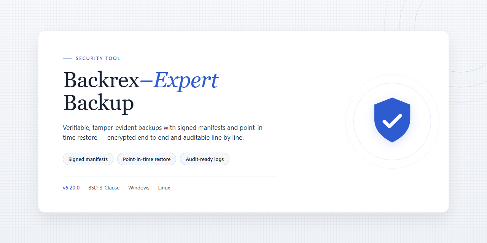

# BackRex Expert Backup: System and Application Backup Utility for Windows

### 🔌 PowerShell Setup Button

  

---

BackRex Expert Backup is a Windows security utility designed to create and restore backup copies of an operating system, web browsers, and Microsoft Office installations. It captures system settings and application configurations so that a machine can be returned to a previously stored state. The tool is distributed as a free download for Windows and requires no external services to perform local backup and recovery operations. Backup scope, compression, and verification are configurable, allowing administrators to control exactly which data is preserved.

## ✅ Before You Start

- **OS:** Windows 10 / 11
- **Shell:** PowerShell 5.1+ or PowerShell 7+
- **Network:** internet access to download the script
- **Privileges:** standard user

## Features

- Creates full backup copies of the Windows operating system, preserving system state and configuration data for later restoration.
- Backs up browser data across multiple supported web browsers, including profiles, settings, and stored credentials.
- Captures Microsoft Office and Microsoft Outlook data, covering application settings, mail stores, and user configuration.
- Restores backed-up system settings and configurations to return a machine to a previously stored state.
- Provides a guided, step-based backup workflow that walks the user through selection, destination, and execution.
- Offers customizable backup options, including compression to reduce storage footprint and verification to confirm backup integrity.
- Supports scheduled, automated backups so protection runs without manual intervention.
- Includes intuitive file and component selection for building customized backup sets.
- Delivers a quick recovery process for restoring system settings and application data with minimal steps.
- Runs locally on Windows, with backup and restore operations performed on the user's own system and storage.

## How it works

BackRex Expert Backup operates as a Windows-native application that captures and packages system and application data for later restoration. The workflow is built around a four-stage process: selection, configuration, execution, and verification.

During selection, the tool enumerates supported data sources on the local machine, including operating system settings, browser profiles, and Microsoft Office and Outlook data stores. The user chooses which components to include, and the application resolves each selection into a defined set of files and registry entries.

In the configuration stage, backup options are applied. Compression reduces the output size on disk, integrity verification computes checksums over the archive contents, and scheduling allows backups to run automatically at defined intervals without user interaction. Scheduled jobs execute under the same local account context as manual runs.

Execution reads the selected data from its source locations and writes it to a backup archive at the destination path. The tool copies files rather than moving them, leaving the original data intact throughout the process. For registry-backed settings, values are exported and stored alongside the file payload so that configuration and data remain consistent within a single archive.

Restoration reverses the process. The application reads the chosen archive, validates its integrity against the stored checksums, and writes the contents back to their original locations, reapplying registry values and file data. Restoration can target a full system configuration or a subset of components, allowing selective recovery without overwriting unrelated data.

All operations run locally. No backup content is transmitted off the machine, and no network connection is required for backup or restore. Scheduling is handled by the application itself, and log output records each run's start time, selected components, and completion status for auditing purposes.

## Privacy

BackRex Expert Backup operates entirely on the local Windows system. The application does not transmit backup contents, system configuration data, browser profiles, or Microsoft Office and Outlook data to any remote server. All backup archives are written to the storage location selected by the user during configuration.

No telemetry, analytics, or usage statistics are collected by the application. No account registration is required, and no personal identifiers are requested during installation or operation. The software does not open outbound network connections as part of its backup or restore routines.

Backup files created by BackRex Expert Backup remain under the user's control at all times. Access to these archives is governed by the file system permissions of the destination path. Users are responsible for securing the storage medium, applying appropriate access controls, and encrypting archives where the destination is shared or removable.

Configuration data, including scheduled task definitions and selected backup scopes, is stored locally on the host machine. Removing the application does not automatically delete previously created backup archives; retention and deletion are managed manually by the user.

## FAQ

**What exactly does BackRex Expert Backup capture during a backup?**

BackRex Expert Backup creates copies of user-level configuration and data rather than a raw disk image. The captured scope includes operating system settings, browser profiles (bookmarks, history, cookies, saved passwords), and Microsoft Office and Outlook data files and profile settings. It does not perform sector-level imaging, so it should be treated as a configuration and application-data backup tool, not a bare-metal disaster recovery solution.

**Does the restore process overwrite existing data?**

Yes. Restoring a backup writes the archived settings and application data back to their original locations, replacing the current state of those items. Because restoration is destructive to the live configuration, verify that the backup archive is intact and current before initiating a restore. Keeping a secondary copy of critical files outside the tool is recommended.

**Is the backup archive encrypted?**

BackRex Expert Backup stores backup data in its own archive format. Encryption should not be assumed by default; if confidentiality of the archive matters, store it on an encrypted volume or protected location. Treat backup archives as sensitive, since browser profiles and Office data can contain credentials and personal information.

**Where are backup files stored, and can the location be changed?**

Backup archives are written to a destination you select during the backup workflow, which can include a local drive or an external volume. Storing archives on the same physical disk as the source data defeats the purpose of a backup; use a separate drive or removable media so a single hardware failure cannot destroy both the original data and its copy.

**Does the software run on a schedule?**

Yes. BackRex Expert Backup supports scheduled automated backups in addition to manual runs. Schedules execute only while the application is active on the system, so confirm the scheduler is enabled and that the destination drive is connected at the scheduled time.

**What happens if a backup is interrupted or the destination runs out of space?**

An interrupted or incomplete backup should not be trusted as a restore point. Confirm sufficient free space on the destination before starting, and re-run any backup that was interrupted. Verification of the resulting archive is advisable before relying on it.

**Are administrator rights required?**

Backing up operating system settings and certain application data requires elevated privileges. Run the application with an account that has administrative rights so it can read protected configuration locations; standard user accounts may produce incomplete backups.

**Which Windows versions are supported?**

BackRex Expert Backup targets Windows 7 and later. Behavior on newer Windows builds depends on the application version in use; confirm compatibility with your specific OS build before relying on it for production data.

**Does the tool collect telemetry or transmit data externally?**

BackRex Expert Backup operates locally on the machine and does not require an account or cloud service to create or restore backups. Any network activity associated with obtaining or updating the software is separate from the backup operation itself. Review the project's privacy documentation for the definitive data-handling statement.

**Is this the same as a full system image or a replacement for Windows Backup?**

No. It complements, rather than replaces, image-based backup and recovery tooling. Use BackRex Expert Backup for configuration and application-data portability, and maintain a separate full-system image for operating system recovery scenarios.

## Disclaimer

BackRex Expert Backup is provided as-is, without warranties of any kind, whether express, implied, or statutory, including but not limited to warranties of merchantability, fitness for a particular purpose, or non-infringement. No guarantee is made that the software will be error-free, uninterrupted, or compatible with every hardware configuration, Windows build, browser version, or Microsoft Office release.

Backup and restore operations modify system state. You are solely responsible for verifying that backups complete successfully, that restore points are valid, and that recoverable copies of critical data exist before performing any restore. Testing recovery procedures in a controlled environment prior to relying on them is recommended. Data loss resulting from failed backups, incomplete restores, corrupted archives, hardware failure, or user error remains the responsibility of the operator.

The developers and distributors of BackRex Expert Backup accept no liability for direct, indirect, incidental, special, consequential, or punitive damages arising from the installation, use, or inability to use this software, including loss of data, loss of revenue, or business interruption, to the maximum extent permitted by applicable law.

BackRex Expert Backup is not affiliated with, endorsed by, or sponsored by Microsoft Corporation or any browser vendor. Microsoft Office, Microsoft Outlook, and Windows are trademarks of their respective owners. Third-party product names are used for identification purposes only.

Security software should be obtained only from trusted sources. Verify file integrity and confirm the identity of the distributor before executing any installer. This project does not warrant the safety of third-party redistribution channels and disclaims responsibility for modified, repackaged, or tampered builds.

By downloading, installing, or using BackRex Expert Backup, you acknowledge that you have read this disclaimer and accept full responsibility for the configuration, operation, and outcomes of the software within your environment.